<div align="center">

# 🏢 企业知识库问答系统 · LangChain + RAG

**一套完整可跑的企业内部知识库问答 Agent：检索 → 增强 → 生成，含管理员后台**

[](https://www.python.org/)
[](https://flask.palletsprojects.com/)
[](https://vuejs.org/)
[](https://www.mysql.com/)
[](https://www.trychroma.com/)
[](https://ollama.com/)

[技术栈](#一技术栈) · [目录结构](#二目录结构) · [RAG 完整链路](#三rag-完整链路本项目核心) · [快速开始](#四快速开始) · [测试账号](#五测试账号) · [常见问题](#七常见问题)

</div>

---

一个基于 **LangChain** 的 RAG（检索增强生成）企业内部知识库问答 Agent 系统。
项目定位为 **入门学习**，代码结构清晰、中文注释完整，适合用来理解 RAG 的完整链路。

> **完全本地化**：对话模型（`qwen3:8b`）与嵌入模型（`qwen3-embedding:4b`）都跑在本地 Ollama 上，文档不出内网。

---

## 一、技术栈

| 层次 | 技术选型 |
| --- | --- |
| 后端 | Python 3.10~3.11 + Flask 3 + Flask-SQLAlchemy |
| 前端 | Vue 3 + Vite + Element Plus + Pinia + ECharts |
| 数据库 | MySQL 8（端口 **3308**，库名 **db_enterprise_qa**） |
| 向量数据库 | Chroma（本地持久化，无需额外部署） |
| 大语言模型 | Ollama **qwen3:8b**（对话生成） |
| 嵌入模型 | Ollama **qwen3-embedding:4b**（文本向量化） |
| 鉴权 | JWT（无状态登录），密码采用 MD5 加密存储 |

---

## 二、目录结构

```
LangChain_RAG/
├── sql/
│   └── db_enterprise_qa.sql      # 建库 + 建表 + 测试数据（可直接整体执行）
├── server/                        # Flask 后端
│   ├── app.py                     # 启动入口（应用工厂 + 全局异常 + 健康检查）
│   ├── config.py                  # 全局配置（数据库/JWT/Ollama/Chroma/切分参数）
│   ├── requirements.txt           # 依赖清单
│   ├── .env.example               # 环境变量示例（复制为 .env 后按需修改）
│   ├── models/                    # ORM 模型（与数据表一一对应）
│   │   ├── user.py                # 用户表 sys_user
│   │   ├── knowledge.py           # 知识库表 / 文档表
│   │   └── chat.py                # 会话表 / 消息表
│   ├── routes/                    # 接口蓝图，统一以 /api 为前缀
│   │   ├── auth_routes.py         # /api/auth   登录、登出、个人信息
│   │   ├── user_routes.py         # /api/user   用户管理（仅管理员）
│   │   ├── kb_routes.py           # /api/kb     知识库与文档管理
│   │   ├── chat_routes.py         # /api/chat   智能问答与会话记录
│   │   └── stats_routes.py        # /api/stats  首页统计图表数据
│   ├── rag/                       # ★ RAG 核心
│   │   ├── document_loader.py     # 文档解析 + 文本切分
│   │   ├── embeddings.py          # 嵌入模型封装 + Ollama 状态检查
│   │   ├── vector_store.py        # Chroma 向量库封装（增删查）
│   │   └── qa_chain.py            # ★ 检索 → 增强 → 生成 问答链
│   ├── utils/
│   │   ├── password.py            # MD5 加密与校验
│   │   ├── auth.py                # JWT 签发/解析 + 权限装饰器
│   │   └── response.py            # 统一返回格式 {code, message, data}
│   ├── uploads/                   # 上传的原始文档（按知识库ID分子目录）
│   └── chroma_db/                 # Chroma 向量库持久化目录
└── client/                        # Vue3 前端
    ├── vite.config.js             # 开发端口 5173，/api 代理到 5000
    └── src/
        ├── api/                   # 接口封装（axios 实例 + 各模块接口）
        ├── router/                # 路由 + 登录/角色守卫
        ├── store/                 # Pinia 状态（当前登录用户）
        ├── layout/                # 管理员布局 / 用户布局
        ├── components/            # 图表面板、Markdown 渲染组件
        ├── composables/           # ECharts 组合式封装
        └── views/
            ├── Login.vue
            ├── admin/             # 数据总览(图表) / 用户 / 知识库 / 文档 / 问答记录 / 问答
            └── user/              # 智能问答 / 个人中心
```

---

## 三、RAG 完整链路（本项目核心）

理解这条链路，就理解了 RAG。对应代码在 `server/rag/` 与 `server/routes/kb_routes.py`、`chat_routes.py`。

```mermaid
flowchart TB
    subgraph offline["离线链路 · 上传文档时执行一次"]
        A([上传 PDF / Word / TXT / MD / CSV]) --> B[保存到 uploads/]
        B --> C[记录 kb_document<br/>status=1 向量化中]
        C --> D[document_loader<br/>解析 + RecursiveCharacterTextSplitter 切分]
        D --> E[embeddings<br/>qwen3-embedding:4b 向量化]
        E --> F[(Chroma<br/>collection = kb_id)]
        F --> G[status=2 已完成<br/>记录 chunk_count]
    end

    subgraph online["在线链路 · 用户每次提问时执行"]
        H([用户提问]) --> I[similarity_search<br/>余弦距离召回 TopK]
        I --> J{相关性达标?}
        J -- 否 --> K([知识库中暂未找到相关内容<br/>不调用大模型])
        J -- 是 --> L[format_context<br/>拼成参考资料]
        L --> M[+ 最近 6 条历史消息]
        M --> N[qa_chain · LCEL<br/>prompt → qwen3:8b → 输出解析]
        N --> O([回答 + 引用来源 + 耗时])
        O -.落库.-> P[(chat_message)]
    end
```



### 1. 离线链路（上传文档时执行一次）

```
上传文档 → 保存到 uploads/ → 记录 kb_document（status=1 向量化中）
   ↓
document_loader.load_and_split()
   ① 按后缀选择加载器解析成纯文本（PDF / Word / TXT / MD / CSV）
   ② RecursiveCharacterTextSplitter 递归切分成 500 字左右的文本块
   ↓
vector_store.add_documents()
   ③ 调用 qwen3-embedding:4b 把每个文本块转成向量
   ④ 连同元数据（doc_id / file_name / kb_id / chunk_index）写入 Chroma
   ⑤ 更新 kb_document（status=2 已完成，记录 chunk_count）
```

### 2. 在线链路（用户每次提问时执行）

```
用户提问
   ↓
vector_store.similarity_search()
   ① 问题向量化，在 Chroma 中按余弦距离检索 TopK 个相关文本块
   ② 过滤掉距离过大（相关性低）的片段
   ↓
qa_chain.RagQaService
   ③ format_context() 把文本块拼成【参考资料】
   ④ 与最近 6 条历史消息一起填入提示词
   ⑤ 交给 qwen3:8b 生成回答（LCEL 链：prompt | llm | StrOutputParser）
   ↓
返回 { 回答内容, 引用来源, 耗时 }，并落库到 chat_message
```

### 3. 关键设计说明

- **知识库隔离**：一个知识库对应 Chroma 中一个 collection（命名 `kb_{id}`），互不干扰。
- **幂等写入**：同一文档重复上传会先删除旧的向量再写入，不会产生重复数据。
- **兜底话术**：检索不到任何资料时，直接返回"知识库中暂未找到相关内容"，不调用大模型（省时省算力，同时避免模型编造）。
- **流式输出**：`POST /api/chat/stream` 使用 SSE，先推送引用来源，再逐段推送回答，前端呈现打字机效果。
- **防幻觉**：系统提示词明确约束"只能依据参考资料作答，禁止编造"。

---

## 四、快速开始

### 一键启动（推荐）

本机已完成全部部署，日常使用直接双击项目根目录的：

| 脚本 | 作用 |
| --- | --- |
| **`start-all.bat`** | 一键启动 MySQL + 后端 + 前端，各占一个窗口 |
| **`start-mysql.bat`** | 只启动 MySQL（3308） |

停止服务：关闭对应的三个命令行窗口即可。

> **重要：本机 MySQL 的启动方式**
> 安装 MySQL 时当前账户无管理员权限，无法注册成 Windows 服务，因此 **mysqld 以普通进程运行，重启电脑后需要手动启动**（运行 `start-mysql.bat`）。
> 如需注册为开机自启的服务，用**管理员身份**执行：
> ```bat
> "C:\Program Files\MySQL\MySQL Server 8.4\bin\mysqld.exe" --install MySQL84 --defaults-file="C:\ProgramData\MySQL\my.ini"
> ```
> 配置文件在 `C:\ProgramData\MySQL\my.ini`，数据目录在 `C:\ProgramData\MySQL\data`。

---

以下是完整的手动部署步骤，换一台机器部署时参考。

### 步骤 0：准备 Ollama 模型

确保本机已安装 [Ollama](https://ollama.com/) 并启动，然后拉取两个模型：

```bash
ollama pull qwen3:8b
ollama pull qwen3-embedding:4b
```

> 提示：`qwen3:8b` 约 5GB，`qwen3-embedding:4b` 约 2.5GB，请预留磁盘空间。
> 拉取完成后可访问 <http://127.0.0.1:11434/api/tags> 确认。

### 步骤 1：初始化数据库

在 **3308 端口**的 MySQL 8 实例上执行初始化脚本（会自动建库、建表、写入测试数据）：

```bash
mysql -h 127.0.0.1 -P 3308 -u root -p < sql/db_enterprise_qa.sql
```

也可以用 Navicat / DataGrip 等工具直接打开 `sql/db_enterprise_qa.sql` 整体运行。
脚本末尾会输出各表数据量，正常为：用户 8 / 知识库 5 / 文档 15 / 会话 15 / 消息 30。

> 注意：MySQL 脚本不会创建"向量数据"。Chroma 中的向量需要你在管理端 **上传文档** 后由系统自动生成。
> 因此刚初始化完时提问会返回"暂未找到相关内容"，这是正常的——上传一份文档即可。

### 步骤 2：启动后端

```bash
cd server
pip install -r requirements.txt

# 可选：复制环境变量示例并按需修改（数据库密码、模型名等）
copy .env.example .env        # Windows
# cp .env.example .env        # macOS / Linux

python app.py
```

启动成功后访问健康检查接口，确认三项状态：

```
http://127.0.0.1:5000/api/health
```

期望返回 `server: ok`、`mysql: ok`、`ollama: ok`，且 `ollama_missing_models` 为空数组。

### 步骤 3：启动前端

```bash
cd client
npm install
npm run dev
```

浏览器会自动打开 <http://127.0.0.1:5173>。

---

## 五、测试账号

所有账号密码统一为 **123456**（数据库中以 MD5 密文 `e10adc3949ba59abbe56e057f20f883e` 存储）。

| 角色 | 账号 | 密码 | 说明 |
| --- | --- | --- | --- |
| 管理员 | `admin` | 123456 | 超级管理员 |
| 管理员 | `manager` | 123456 | 知识库管理员 |
| 普通用户 | `zhangsan` | 123456 | 张三 / 研发中心 |
| 普通用户 | `lisi` | 123456 | 李四 / 市场营销部 |
| 普通用户 | `wangwu` | 123456 | 王五 / 人力资源部 |
| 普通用户 | `zhaoliu` | 123456 | 赵六 / 财务部 |
| 普通用户 | `zhouba` | 123456 | 周八 / 客户服务部 |

> 另有 `sunqi` 账号状态为"禁用"（status=0），可用于验证禁用用户无法登录。

---

## 六、功能一览

### 管理员（role=admin）

| 页面 | 功能 |
| --- | --- |
| 数据总览 | 统计卡片 + 6 类 ECharts 图表：问答趋势、知识库排行、用户提问排行、分类分布、文档状态、最近提问 |
| 用户管理 | 用户增删改查、启用/禁用、重置密码 |
| 知识库管理 | 知识库增删改查、分类筛选 |
| 文档管理 | 上传文档（自动解析+向量化）、重新向量化、删除 |
| 问答记录 | 查看全部用户的会话与消息明细 |
| 智能问答 | 同普通用户的问答界面 |

### 普通用户（role=user）

| 页面 | 功能 |
| --- | --- |
| 智能问答 | 选择知识库、多轮对话、流式打字机输出、展示引用来源 |
| 个人中心 | 修改个人资料、修改密码 |

---

## 七、常见问题

**Q1：提问总是返回"知识库中暂未找到相关内容"？**
按顺序排查：① 是否已上传文档且状态为"已完成"；② 提问时是否选中了对应的知识库；③ `RETRIEVE_SCORE_THRESHOLD` 是否过小（默认 1.0，可调大到 1.2 提高召回）。

**Q2：上传文档后状态一直是"失败"？**
查看 `kb_document.error_msg` 字段的失败原因，以及后端控制台日志。常见原因是 Ollama 未启动或嵌入模型未下载。

**Q3：后端报 MySQL 连接错误？**
确认 MySQL 实例确实监听 **3308** 端口（不是默认的 3306），以及 `server/.env` 中的账号密码正确。

**Q4：前端接口 404 / 跨域？**
开发环境下前端通过 Vite 代理访问后端，确认后端已在 5000 端口启动。若单独直连后端，CORS 已在 `app.py` 中放开 `/api/*`。

**Q5：如何调整问答效果？**
修改 `server/.env` 中的 `CHUNK_SIZE`（文本块大小）、`RETRIEVE_TOP_K`（检索条数）、`RETRIEVE_SCORE_THRESHOLD`（相关性阈值）、`LLM_TEMPERATURE`（回答随机性，知识库问答建议保持 0~0.3），改完重启后端即可。

**Q6：上传文档后报错 `failed to allocate CPU_REPACK buffer` / `llama-server process has terminated`？**

这是**内存（提交内存）不足**，不是代码问题。Ollama 加载嵌入模型约需 1.8GB、加载 `qwen3:8b` 约需 6GB，两个模型合计需要 **8GB 以上的可用提交内存**。

排查与解决：
```powershell
# 查看提交内存使用情况：已提交 / 上限
Get-Counter '\Memory\Committed Bytes','\Memory\Commit Limit'
```
若"已提交"接近"上限"，任选其一：
1. **关闭占内存的程序**（浏览器多开标签页、ChatGPT/Electron 类应用最占），再重试上传。
2. **扩大页面文件**：系统属性 → 高级 → 性能设置 → 高级 → 虚拟内存 → 更改，把上限调大（如 64GB），重启后提交上限随之提升。
3. 减少 Ollama 同时加载的模型数，设置环境变量 `OLLAMA_MAX_LOADED_MODELS=1` 后重启 Ollama。

定位到这一问题的标志：后端日志会打印 `llama-server process has terminated: exit status 1: ... failed to allocate buffer`，同时 `kb_document` 表中该文档 `status=3`、`error_msg` 记录了同样的原因。

---

## 八、学习建议路线

1. 先跑通系统，用管理员账号上传一份 PDF，再用普通账号提问，直观感受 RAG 效果。
2. 读 `server/rag/qa_chain.py` —— 这是整个系统的心脏，理解"检索 → 增强 → 生成"。
3. 读 `server/rag/vector_store.py` —— 理解向量库如何增删查，以及元数据的作用。
4. 读 `server/rag/document_loader.py` —— 理解为什么要切分、怎么切分。
5. 读 `server/routes/chat_routes.py` —— 理解一次问答请求从前端到落库的完整流程。
6. 尝试改造：换用别的模型、调整切分参数、给提示词加规则，观察回答质量的变化。
